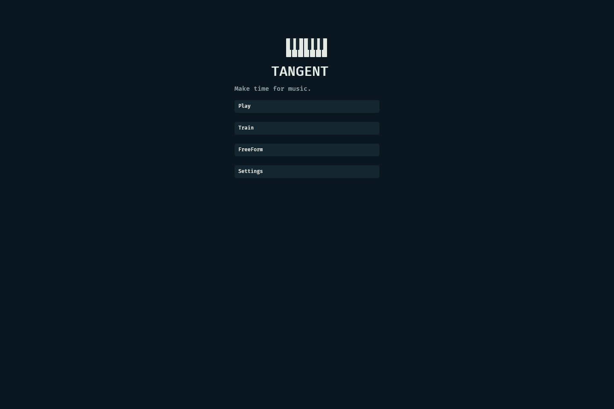
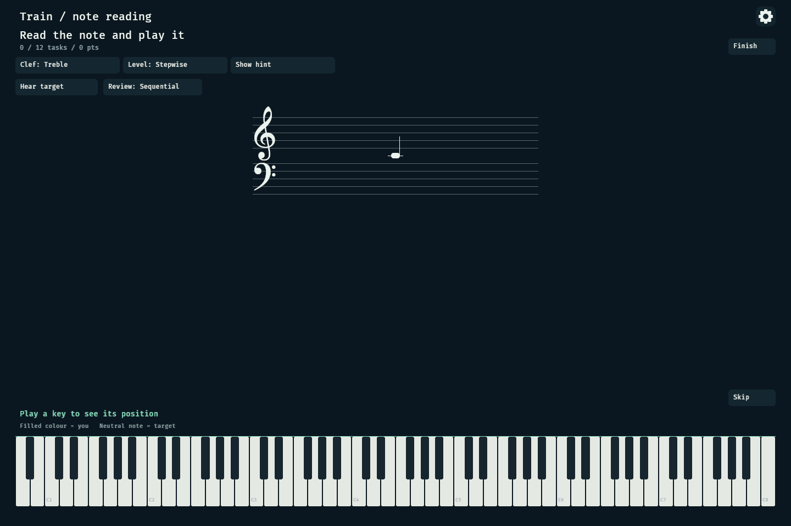
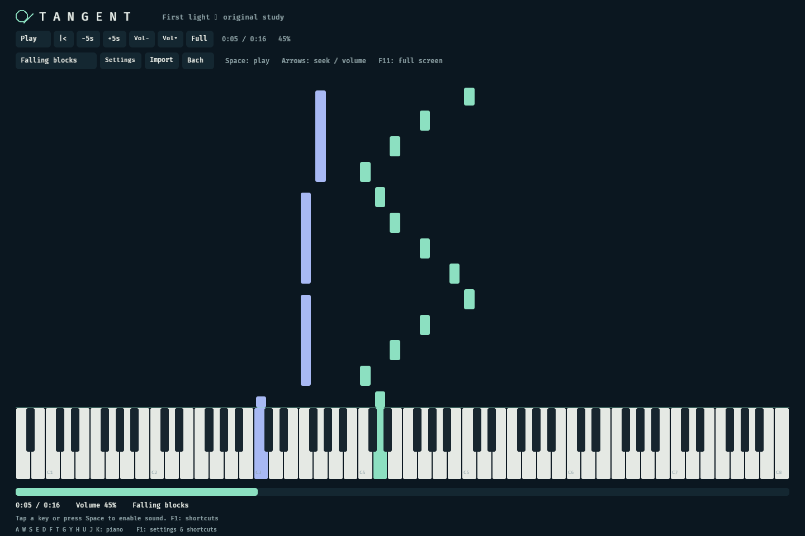
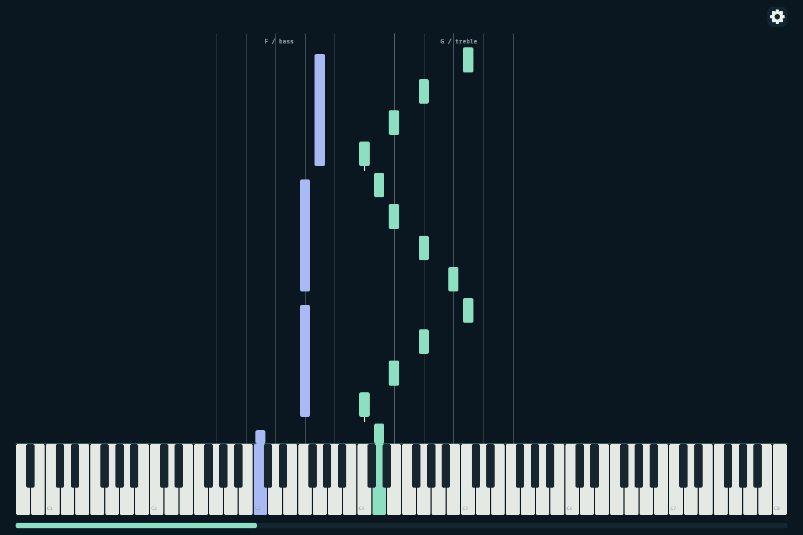
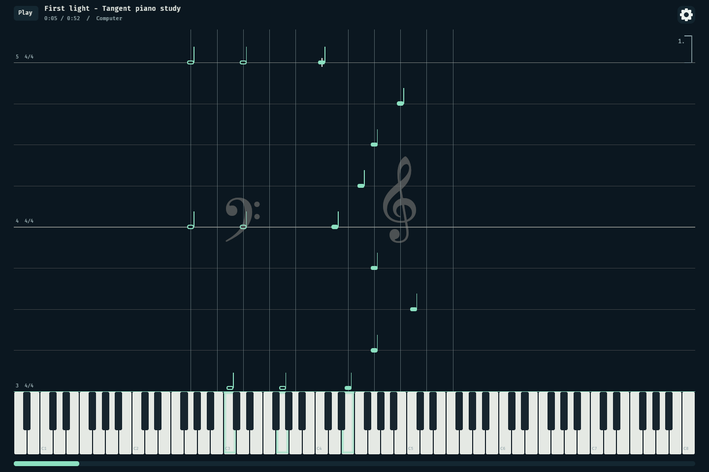
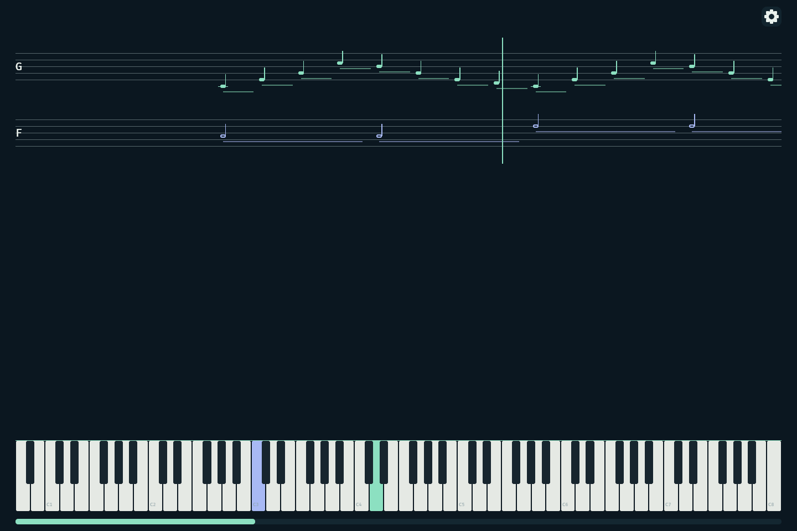
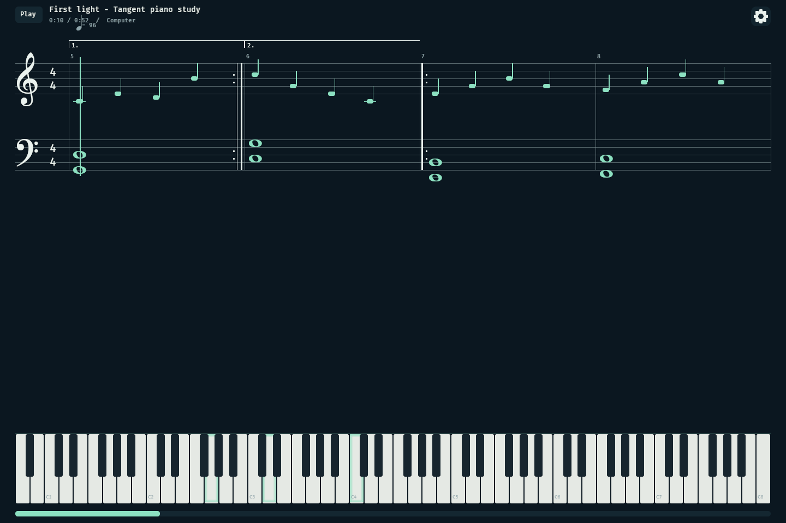
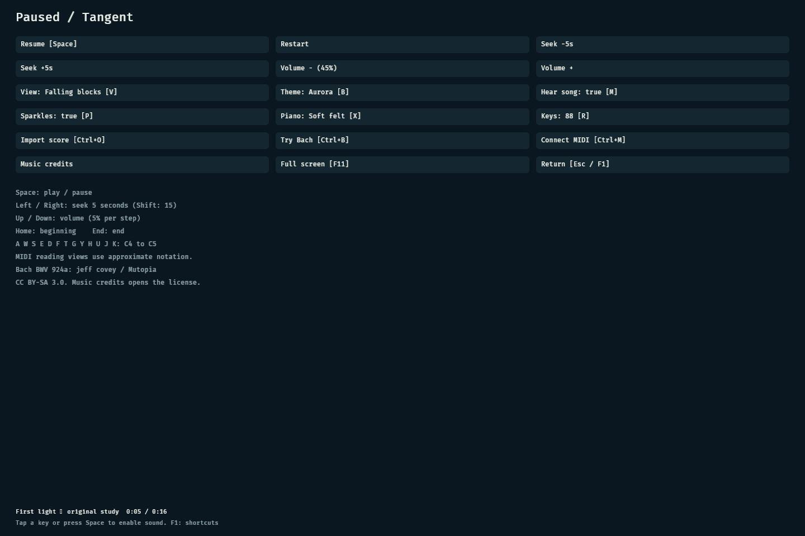

# Tangent

Piano practice, note reading and music playback, built around **Bevy** with
**web as a first-class deployment target**.

Tangent is a new project with its own repository and history. The goal is an
independent implementation, developed through a documented clean room process,
without importing Neothesia or code from its forks.

[Play in the browser](https://passeride.github.io/Tangent/) ·
[Download platform builds](https://github.com/passeride/Tangent/actions/workflows/check.yml) ·
[Run/build guide](docs/distribution.md)

The browser link becomes available after the first successful Pages deployment.
The bundled **First light** MusicXML piano study includes bass/treble staves,
16 written measures, first/second endings, repeats, meter and tempo changes.
Choose **Play** from the new main menu, then press **Space** to play, **V** for the note views, or choose **Load sample** in **Settings → Data & About**. The original demo is [CC0 1.0](web/piano/samples/ATTRIBUTION.md).

During play, only the corner gear and timeline remain. The pause overlay has
Resume, transport, quick view/audio, Settings and navigation. Full settings are
organized into Audio & MIDI, Visuals, Practice, Effects, Accessibility (planned),
and Data & About. Opening Pause stops playback and releases live notes; returning
from Settings stays paused until Resume.

The UI v2 branch opens at a responsive, action-card main menu: **Play**, **Library**, **Train**, **FreeForm**, and
**Settings**. Train offers treble/bass note reading with three levels, optional hints and diatonic chord exercises; FreeForm
keeps song playback silent. Return home from the corner-gear pause screen.

## Screenshots

Actual running app, captured with Chromium at 1440 px width using Tangent's
original demonstration study. These are app screenshots, not design mockups.

| Staff lanes with ledger lines | Falling noteheads |
| --- | --- |
|  |  |

The screenshots above are baseline captures from the previous UI; they have not
been regenerated for UI v2. See [UI/UX v2 design](docs/design/tangent-ui-v2.md).

Reproduce with `node web/piano/capture.mjs` after building the WASM package.

## Platform builds

The web player remains available through Pages. A separate **native Bevy desktop
binary** now targets Windows x64/ARM64, Linux x64/ARM64 and macOS Intel/Apple
Silicon. It uses the OS GPU backend through wgpu and opens its own window,
not a browser wrapper. Desktop MIDI (midir), audio (rodio) and SQLite
(rusqlite with bundled SQLite) run natively. See
[desktop builds and limitations](docs/distribution.md). Android/iOS use the web version.

Choose **Library** to import several files, search title/composer, edit metadata,
sort/filter, reopen and remove saved pieces. Windows packages include a short
[P-45 test](docs/test-p45.md) and PowerShell report starter.
See [music library](docs/music-library.md) for limits and backup behavior.

To hear playback through your piano, open **Settings → Rescan MIDI → Output**
and cycle to its MIDI port (for example Digital Piano / P-45). The selected output
replaces computer audio; leave the piano's Local Control On. Physical piano input
is not echoed. **Solid keys mean played input; glowing edges mean expected song
notes.** Train → Notes offers treble, bass or both clefs, three levels and Show hint.
The answer stays visible until all keys are released. See [MIDI and practice details](docs/adr/0015-midi-output-and-reading-practice.md).

## Project status

**Playable web player and native desktop implementation (pending hardware validation).** The Rust workspace has a format-neutral
music/piano model, one Bevy application with in-engine UI/wgpu rendering and a Web Audio adapter.
Play with keyboard, pointer or touch; import MIDI, switch between four note
views, choose a theme/piano profile and enable or disable sparkles and song audio.

See [piano build/run/test instructions](docs/piano-player.md) and the
[MIDI support contract](docs/midi-import.md). The web version has Web MIDI/Web
Audio and browser-local SQLite. The desktop branch uses the same Bevy GPU UI and
musical core with native keyboard/pointer, multidevice MIDI input, a separate
audio scheduler thread, a local SQLite file and OS file dialogs.
Partwise MusicXML (.xml/.musicxml/.mxl) import is an [explicit subset](docs/musicxml-import.md).
Desktop build and MIDI/audio behavior require physical machine verification,
especially low-latency playing. The native instrument is currently an efficient
harmonic voice, not the same timbre as the browser synthesizer. The local
music library now saves original imports locally; recording meaningful scores remains future work.

The implementation is not certified as a completed clean room process. Prior
source exposure remains documented in [PROVENANCE.md](PROVENANCE.md).

## Product direction

- Connect a MIDI piano and show the notes being played.
- Practice reading notes in treble and bass clefs, and learn common chords.
- Play MIDI pieces with a virtual keyboard, falling notes and optional notation.
- Offer focused practice and a separate scored performance mode.
- Keep a personal music library, preferences and progress.
- Add MusicXML support with an explicit supported subset and synchronized notation.

These are product goals; the current piano slice implements a subset. Browser MIDI, audio and file
access must be validated on target devices; keyboard and on-screen input should
remain useful when hardware MIDI is unavailable.

## Technical direction

Bevy owns the application, UI, keyboard/pointer input and GPU drawing in one
full-page canvas. The browser adapter supplies audio, file/device capabilities
and fullscreen, with no separate HTML application menus. Musical data, exercise rules and
performance evaluation should be independently testable. Browser audio, MIDI,
file access and persistence need explicit platform boundaries.

The sound/clock boundaries are recorded in ADR-0003; ADR-0005 replaces its
initial Canvas/HTML presentation with a single Bevy GPU surface. Full
notation layout, sampled sound and further formats require separate decisions.

## Documentation

| Area | Purpose |
| --- | --- |
| [Piano player](docs/piano-player.md) | Playable web slice and run/test commands |
| [Follow-up work](docs/TODO.md) | Remaining implementation and architecture work |
| [MIDI import](docs/midi-import.md) | Implemented scope, limitations and build/test commands |
| [Documentation index](docs/README.md) | Entry point for architecture and design work |
| [Architecture decisions](docs/adr/README.md) | Decision history, statuses and ADR template |
| [Product and visual design](docs/design/README.md) | Design questions, briefs and sketch index |
| [Sketches](docs/design/sketches/README.md) | Wireframes, flows and visual explorations |
| [Design assets](docs/design/assets/README.md) | Source files and asset provenance |
| [Provenance](PROVENANCE.md) | Source boundaries, exposure and future dependency records |
| [Agent guidance](AGENTS.md) | Instructions for automated contributors |

## First milestones

1. Document the requirements and implementation provenance.
2. Prove browser rendering, piano input, sound activation and local persistence.
3. Build a small MIDI playback and virtual-piano slice.
4. Expand into practice, library and scored performance after those foundations work.

The importer and initial web piano/playback slice are delivered. Persistence,
full notation and advanced practice/performance modes remain open in [the backlog](docs/TODO.md).

## Contributing

Read the relevant design brief and ADR before changing a cross-cutting decision.
Use the templates to explain the problem, alternatives and evidence. Keep proposals
clearly separate from accepted decisions and delivered behavior.

Do not copy implementation code, wrappers, fixtures, shaders or assets from
Neothesia or its forks. Independently published dependencies and assets need their
own license and provenance record. Do not treat a fresh repository or AI context
as proof of source independence.

## Licensing

A project-wide license has not been selected. Do not assume that this repository
is MIT, Apache-2.0 or licensed under the terms of another Tangent project.
Dependencies retain their own licenses: see [THIRD_PARTY.md](THIRD_PARTY.md) and
[license notices](THIRD_PARTY_NOTICES.txt). Fonts, music and audio assets will
require their own records when introduced.

## Player shortcuts

| Action | Shortcut |
| --- | --- |
| Play / pause | Space |
| Seek backward / forward | Left / Right (5s), Shift for 15s |
| Volume down / up | Down / Up (5%) |
| Beginning / end | Home / End |
| Fullscreen | F11 or Settings → Visuals |
| Pause / Settings | Corner gear or Esc/F1 (session); Settings from pause or Main; Space resumes from pause |
| View / theme / piano / range | V / B / X / R |
| Song audio / particles | M / P |
| Import / MusicXML demo / MIDI | Ctrl+O / Ctrl+B / Ctrl+M |

Staff notes and staff blocks both include five-line bass and treble staves,
with ledger strokes outside them. All menus are inside the GPU canvas.

MusicXML's sheet view now uses written measures, real Bravura G/F clefs, meter,
tempo, key signatures, repeat signs and first/second-ending brackets. The playhead
follows repeat visits. Falling staff/notes show faint clef watermarks plus moving
measure/beat guides and endings. MIDI remains an approximate reading view.
